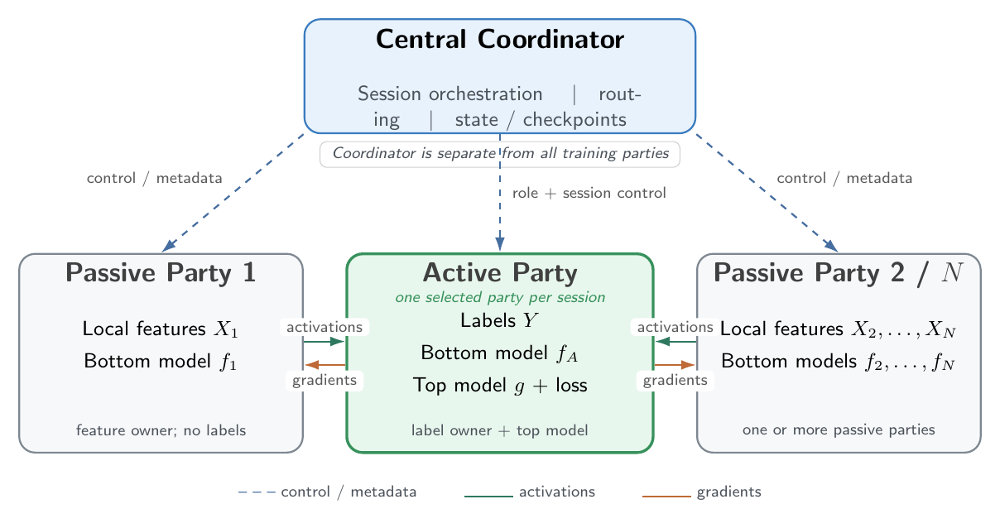

# Vertical Federated Learning over Heterogeneous Networked Systems

**Privacy-Preserving VFL with Central Coordination — Project Requirements Document (PRD)**

OnCloud9 — 30 September 2026 — v3

| Member | Roll no. | Email |
|---|---|---|
| Amisha Sadhukan | 26386 | amishas@iisc.ac.in |
| Atrayee Samanta | 26437 | atrayees@iisc.ac.in |
| Lavish Singh | 26318 | lavishsingh@iisc.ac.in |
| M. Divya | 26454 | divya2@iisc.ac.in |

> This is the original plan (PRD v3) as submitted, converted to Markdown without changes to its content. How the
> implementation meets each requirement is in [docs/PROJECT_DOCUMENTATION.md](docs/PROJECT_DOCUMENTATION.md) §5.

**Summary:** Build and evaluate a reproducible, networked two-party VFL system with extensible party interfaces,
measured systems trade-offs, explicit privacy boundaries, and conditional cloud, PSI and inference-defence
extensions.

---

## 1. Problem Statement and Motivation

Federated learning (FL) enables organizations to train a shared machine-learning model while retaining raw data
within their own infrastructure. It is important when useful data are distributed across institutions and cannot
readily be pooled because of privacy, governance or operational constraints. Keeping raw data local reduces the need
for centralized data collection, but does not by itself prevent information leakage through model updates or
intermediate training messages [2, 6].

Two main forms of FL are horizontal federated learning (HFL) and vertical federated learning (VFL). In HFL,
participants typically hold the same feature schema for different entities and collaborate through model-update
aggregation. In VFL, participants hold complementary feature sets for overlapping entities and train jointly after
aligning those entities [2, 3]. For example, a label-owning institution may hold outcomes and some features while a
partner holds additional features for the same individuals.

This project focuses on split-model VFL with central coordination. Local models compute representations from each
party's feature partition; the active party combines those representations, computes the loss using its labels, and
returns the required gradients. These forward and backward exchanges occur for every mini-batch, making entity
alignment, synchronization, network latency, communication volume and privacy leakage central systems concerns
[2, 3, 7]. Our central question is: **How do batch-level synchronization, network placement and feature
partitioning affect the utility and systems cost of a reproducible VFL deployment?**

The coordinator manages membership, batch scheduling and execution state, while labels, the top model and loss
remain at the active party. This separation provides an explicit trust boundary and a framework-independent
coordination interface. Flotilla motivates modular deployment and fault-aware design; integration remains a stretch
goal rather than a dependency of the standalone system [1].

Separate processes and machines are necessary to measure actual transport, resource isolation, synchronization and
deployment effects. A single-process implementation remains useful for correctness tests, but is not the
networked-system evaluation.

## 2. Scope, Assumptions and Threat Model

### Core scope

- A synchronous, two-party reference system: one active (label-owning) party, one passive (feature-owning) party
  and a separate coordinator. Interfaces permit additional passive parties, but general multi-party support is not
  an MVP acceptance condition.
- Deterministic entity alignment on public/synthetic data, with a replaceable alignment interface; deterministic
  mini-batches and local bottom-model updates.
- A top model and loss at the active party; the coordinator handles session/control state and telemetry, not labels
  or top-model inputs.
- gRPC/Protocol Buffers transport, authenticated/encrypted channels for the networked deployment, duplicate-message
  suppression within an uninterrupted run, and machine-readable telemetry.
- Centralized and active-party-only baselines on the same aligned entities, plus local/LAN latency and
  communication experiments.

### Conditional deliverables

- A reviewed private-set-intersection (PSI) implementation, including documentation of which party learns the
  intersection. Until then, the alignment mode is explicitly labelled non-private experimental alignment [8].
- A cloud-hosted coordinator and a measured cloud-cost comparison, subject to access and budget.
- One defence against a specified training-time inference threat, evaluated against an explicit attack or privacy
  metric. This is separate from PSI and transport encryption [5, 6].

### Out of scope and assumptions

Production compliance, real sensitive records, arbitrary dynamic membership, general crash-safe exactly-once
transactions, automatic autoscaling and Flotilla integration are outside the core deliverable. Parties agree on a
stable identifier format; experiments use synthetic/public tabular data. The initial model assumes
protocol-following, honest-but-curious parties and a coordinator that does not inspect training payloads in the
primary design. If a relay can read representations or gradients, it is explicitly included in the threat model.
Transport security protects against network observers, not inference by an authorized recipient. PSI can reveal the
matched intersection depending on its protocol and output policy [8, 5].

### Privacy mechanisms and supporting evidence

**Entity alignment (conditional PSI).** A reviewed PSI protocol identifies common entities without disclosing the
full input sets beyond the protocol's specified outputs and leakage. Practical OT-extension-based PSI provides a
research basis for selecting an implementation; its security assumptions and intersection-output policy must match
our threat model [13, 8].

**Transport protection (core mTLS).** TLS protects messages in transit; mutual certificate authentication verifies
both communicating endpoints. It does not prevent an authenticated party from inferring information from the tensors
it receives [14, 6].

**Differential privacy (conditional inference defence).** Differential privacy (DP) bounds how much a released
output distribution changes between neighboring datasets, expressed through (ε, δ) [11]. DP-SGD provides a training
approach based on per-example gradient clipping, calibrated Gaussian noise and privacy accounting [12]. If DP is
selected for FR-13, the design shall state the protected information (e.g., labels), neighboring-dataset definition,
adversary and noise-insertion point; account for all relevant releases across batches and epochs; and report
clipping norm, noise multiplier, sampling assumptions, (ε, δ), utility and overhead. Applying DP-SGD to a local
model does not automatically protect a VFL message transcript: every exposed representation or gradient relevant to
the stated guarantee must be covered by the analysis. Noise without valid sensitivity bounds and composition
accounting is reported as perturbation, not as a formal DP guarantee [11, 12, 5].

## 3. Stakeholders and Usage Scenarios

**Roles:** active/label-owning party; passive/feature-owning party; coordinator/operator; ML researcher/evaluator.

**Scenario 1 — Correctness prototype.** Two parties align public/synthetic records and train a split model locally.
Tests confirm the matched ordering, gradient shapes and parameter updates without sending raw feature tables.

**Scenario 2 — Networked systems study.** The same workload runs across separate LAN machines with controlled
delay. The operator measures utility, wait time, batch latency, bytes and resource use against centralized and
active-party-only baselines.

**Scenario 3 — Conditional extensions.** If core results are stable, a reviewed PSI implementation, cloud
coordinator or inference defence is added and assessed with its own acceptance tests. An unfinished extension is
reported as such, not described as a privacy or cloud result.

## 4. Functional Requirements

| ID | Priority | Testable capability and acceptance criterion |
|---|---|---|
| FR-1 | Must | Initialize an active party, at least one passive party and a coordinator. Reject missing/invalid roles; successfully start the two-party reference run. |
| FR-2 | Must | Align entities through a replaceable interface. On a seeded public/synthetic test set, experimental alignment returns the reference intersection; unmatched IDs are absent from application logs. This mode is not called private. |
| FR-3 | Must | Create deterministic aligned mini-batches. Repeated runs with the same seed yield identical batch membership and ordering. |
| FR-4 | Must | Each party computes its bottom representation locally. Message inspection finds representations, not raw feature columns or labels. |
| FR-5 | Must | The active party combines its representation with those of participating passive parties, computes the top model and loss, and returns each required representation gradient. A committed batch produces finite loss and correctly shaped gradients. |
| FR-6 | Must | Enforce synchronous per-batch execution. Injected delay in a required message appears in measured waiting/batch time, subject to stated clock and scheduling tolerance. |
| FR-7 | Must | Update local parameters after a committed batch. At least one relevant tensor changes for a non-zero learning rate and non-zero gradient. |
| FR-8 | Must | Identify messages by session, epoch, batch, attempt, sender and type; suppress duplicates within an uninterrupted run. Replaying a committed message triggers no additional optimizer step. This does not claim crash-safe exactly-once execution. |
| FR-9 | Must | Configure dataset, seed, batch size, model dimensions and epochs without source edits. Three batch-size configurations run successfully. |
| FR-10 | Must | Emit machine-readable per-batch and per-run records for utility, timing, wait time, serialized bytes and resource use, keyed by run/session ID. |
| FR-11 | Must | Authenticate and encrypt networked transport. Invalid credentials are rejected and packet inspection finds no plaintext application payload. |
| FR-12 | Could | Integrate a reviewed PSI protocol for alignment. A known-overlap test returns the correct intersection and documentation states which party learns it and what metadata remains exposed. |
| FR-13 | Could | Implement one configurable defence against a specified training-time inference threat. Report attack/privacy metric, utility, communication and time with and without the defence on the same workload. |
| FR-14 | Could | Expose a Flotilla adapter after the standalone core is stable. Launch a small smoke run without rewriting the VFL training core. |

## 5. Non-Functional Requirements

| ID | Target and measurement |
|---|---|
| NFR-1 | **Utility.** On a fixed binary-classification workload, final VFL test AUROC is within 5 percentage points of the equivalent centralized model trained and evaluated on the same aligned entities. Use identical partitions, preprocessing, split, architecture capacity, optimizer and seeds where applicable; report accuracy and AUROC over three seeds. |
| NFR-2 | **Reproducibility.** The same seed/configuration yields identical aligned order and committed-step count; report final-loss variation across three repetitions and investigate variation above 5%. Record software versions and deterministic-computation settings. |
| NFR-3 | **Latency.** At injected RTTs of 0, 20, 50 and 100 ms, report median epoch time and p50/p95 batch time on a fixed CPU workload. The 2.0 s p95 batch-time target applies to the reference LAN configuration only if baseline compute time permits; WAN-like settings are reported, not assumed to meet it. |
| NFR-4 | **Communication.** Report tensor payload, serialized application bytes and, where measurable, network bytes separately, in MiB/epoch and MiB/distinct aligned entity. Unprotected FP32 tensor payload must match the calculated element count and dtype; quantify protobuf/control/TLS overhead rather than expecting total traffic to equal tensor bytes. |
| NFR-5 | **Throughput.** Target at least five committed batches/s on the reference LAN setup without injected delay, or report the achieved value and bottleneck. Measure committed batches divided by training wall time, excluding one-time setup. Report RTT-sweep throughput without imposing the LAN target. |
| NFR-6 | **Efficiency.** Record coordinator/party CPU and memory use. If an efficiency variant is implemented, target a 10% reduction in bytes per entity or epoch time without more than a 5-percentage-point AUROC loss, using paired seeds. Otherwise report the baseline without claiming an optimization. |
| NFR-7 | **Transport and logging.** Reject all 100 scripted invalid-certificate connection attempts; find zero raw feature values or labels from a controlled sentinel dataset in application logs. These checks do not establish resistance to authorized-party inference. |
| NFR-8 | **Conditional privacy evaluation.** If FR-13 is implemented, report its parameter when applicable (e.g., (ε, δ) for DP), the protected information, adjacency definition, clipping/noise parameters, composition accountant, a defined attack/privacy metric, utility and overhead on paired workloads [11, 12]. If FR-12 is implemented, separately report PSI disclosure, time and bytes. |
| NFR-9 | **Conditional cloud cost.** If cloud experiments run, report measured VM time, storage and paid egress using a recorded region, currency and price snapshot; report cost per 1,000 distinct aligned training entities and per epoch, separating one-time setup. |
| NFR-10 | **Fault handling.** Inject a duplicate message and a 2 s delay. Report whether the delayed run completes or times out diagnostically, verify no duplicate optimizer step during an uninterrupted run, and measure epoch-checkpoint recovery time if restart support is implemented. No general 60 s recovery guarantee is claimed. |

## 6. System Architecture and Technology Stack

### 6.1 Architecture and data flow

For the primary design, the active party owns labels, its local bottom model, the top model and the loss. Passive
parties own disjoint feature partitions and bottom models. For aligned batch *b*, party *i* computes
$H_i^b = f_i(X_i^b)$ and sends only the required representation to the active party. The active party computes

$$L_b = \ell\big(g(H_0^b, H_1^b, \ldots),\, Y^b\big)$$

and returns $\partial L_b / \partial H_i^b$ to each passive party; parties update their own parameters. The
coordinator manages membership, batch/session identifiers, control messages and telemetry. It does not receive raw
features, labels or top-model loss inputs in the primary design. Alternative top-model placements require a separate
privacy analysis, not merely a configuration change [2, 6].

*Figure 1: Architecture of the proposed Vertical Federated Learning system.*

Before training, parties use the replaceable alignment interface to establish a common ordered entity set. The core
experimental adapter is deterministic but not privacy-preserving; a reviewed PSI adapter is a separate conditional
deliverable. The chosen PSI output policy must specify who learns the intersection and any associated metadata [8].
Each batch has a session/epoch/batch/attempt identity. Duplicate suppression covers uninterrupted execution;
checkpoint replay must be validated separately.

### 6.2 Choices, alternatives and literature rationale

- **Split PyTorch models:** local feature computation and active-party loss implement the common VFL
  representation/gradient workflow. This enables tensor-level correctness tests, but gradients can leak information,
  so the architecture is not described as intrinsically private [2, 6].
- **Central coordination:** a separate coordinator manages session state, membership, batch scheduling and
  telemetry through framework-independent interfaces. Training tensors are exchanged directly between the parties;
  labels and the top model stay at the active party. An optional Flotilla adapter reuses the standalone training
  core [2, 1].
- **Synchronous first:** it simplifies batch correctness and attribution of wait time. Communication-efficient VFL
  literature motivates measuring the resulting bottleneck; asynchronous training is deferred rather than assumed
  superior [3, 7].
- **gRPC/Protocol Buffers:** typed service definitions, structured payloads, streaming and deadlines fit repeated
  batch exchanges. REST/HTTP is a plausible alternative, but no performance superiority is asserted without
  measurement [9, 10].
- **Reviewed PSI adapter:** alignment is necessary for overlapping records, while protocol-dependent intersection
  disclosure makes an invented or unspecified "private" alignment inappropriate [8].
- **mTLS and optional inference defence:** mTLS authenticates/encrypts network connections; it does not hide
  representations from an authorized receiver. Any training-time defence therefore needs its own threat model and
  utility/attack evaluation [14, 5, 6].
- **Docker, LAN then optional cloud VM:** reproducible packaging and a local fallback limit deployment risk.
  Controlled RTT injection separates network effects from uncontrolled Internet variability. Flotilla's
  distributed/resilience study motivates, but does not prove, portability of this VFL protocol [1].

## 7. Evaluation Plan

### 7.1 Workload and fairness controls

Use one public or synthetic tabular binary-classification workload with a reproducible vertical partition. Record
entity count, overlap ratio, party feature counts, feature importance/correlation, split, seed, batch size and model
dimensions. VertiBench shows why arbitrary feature splits can miss important distribution effects [4]. Align before
splitting into training/validation/test, or otherwise ensure the same entity-level split is used across parties
without leakage. All primary comparisons use the same aligned entities, splits, preprocessing, seeds and stopping
rule. A centralized reference matches the VFL model's effective capacity as closely as practicable; any remaining
architectural differences are disclosed.

### 7.2 Baselines and configurations

- **B0 Centralized:** joined features for the aligned entities on one machine; establishes a utility reference
  without VFL network exchanges.
- **B1 Active-party-only:** supervised training using only active-party features and labels on the same entities.
  Passive parties cannot independently train the specified supervised baseline because they do not own labels.
- **C1 Local/LAN VFL:** two-party synchronous VFL; the primary correctness and systems configuration.
- **C2 Cloud-coordinator VFL (conditional):** same training protocol with a cloud-hosted coordinator; placement, RTT
  and costs are measured if resources permit.
- **C3 Defence-enabled VFL (conditional):** C1 or C2 with one specified inference defence; compare against the
  identical undefended configuration.
- **C4 Flotilla adapter (stretch):** only after the standalone experiments are reproducible.

### 7.3 Metrics and experiments

Record utility (AUROC, accuracy, F1, loss), convergence (epochs and wall time to a prespecified validation target),
p50/p95 batch latency, epoch time, wait/compute time, throughput, CPU/memory, tensor/application/network bytes and
alignment cost. Report mean and spread over three seeds; define the threshold before comparing methods. These
utility, efficiency and privacy dimensions are motivated by VFL surveys and privacy-utility evaluation work
[2, 3, 5].

- **E1 — Correctness and utility (core).** Compare B0, B1 and C1 on identical aligned entities. Validate FR-1–FR-5,
  FR-7 and NFR-1/NFR-2; plot AUROC and loss versus epoch.
- **E2 — Network and efficiency (core).** Sweep RTT ∈ {0, 20, 50, 100} ms and batch size ∈ {32, 64, 128} for C1,
  with paired seeds and fixed useful work. Validate FR-6, FR-9/FR-10 and NFR-3–NFR-6. Report time, wait, throughput
  and byte breakdown. If C2 exists, repeat a comparable subset and report actual measured RTT.
- **E3 — Security and conditional privacy.** Test FR-11/NFR-7 with invalid certificates, packet capture and
  sentinel-log audit. If FR-12 exists, report PSI correctness, output disclosure, time and bytes. If FR-13 exists,
  evaluate a defined attack/privacy metric and compare defence-on/off utility and overhead; do not conflate PSI with
  gradient protection [8, 5].
- **E4 — Conditional cloud cost.** If C2 exists, compare it with C1 under equivalent aligned work, report placement
  and price snapshot, and validate NFR-9.
- **E5 — Fault and reproducibility (core).** Inject duplicate messages and a 2 s required-message delay; verify step
  counts and diagnosable timeout/continuation. If checkpoint restart exists, report recovery time and consistency.
  Validate FR-8 and NFR-2/NFR-10.
- **E6 — Flotilla (stretch).** If C4 exists, compare its smoke-run correctness and orchestration overhead with the
  standalone system; validate FR-14.

### 7.4 Cost model

For cloud experiment *r*,

$$C_r = \sum_i p_i \frac{t_i}{3600} + p_{\text{storage},h}\, G_r\, h_r + p_{\text{egress}}\, E_r, \qquad C_{r,1000} = \frac{1000\, C_r}{N_r}$$

where $p_i$ is VM price per hour, $t_i$ is active seconds, $p_{\text{storage},h}$ is storage price per GB-hour, $G_r$
is stored GB, $h_r$ is storage hours, $p_{\text{egress}}$ is price per paid egress GB, $E_r$ is paid egress GB and
$N_r$ is the number of distinct aligned training entities in the completed run. Record currency, region, price date
and whether taxes/free-tier credits are excluded. Report setup/alignment separately. If processed entity-epochs are
reported, use a separately named denominator rather than calling them distinct samples.

### 7.5 Expected results

Deliver a requirement-to-experiment matrix, run configurations and machine-readable logs. Plots/tables include
utility versus epoch; epoch and p95 batch time versus RTT; throughput versus RTT/batch size; tensor and serialized
bytes per aligned entity; conditional privacy metric versus utility; conditional cloud cost breakdown; and an NFR
measured-value/pass/fail/not-attempted table.

## 8. Work Plan and Milestones

| Week | Lavish + Divya: Data and ML | Atrayee + Amisha: Systems and Evaluation |
|---|---|---|
| 1 | Prepare vertical data splits, deterministic alignment and the local two-party model. | Define protocol interfaces, set up the repository and build the local launch and logging workflow. |
| 2 | Complete forward/backward training and centralized and active-party-only baselines. | Implement batch identifiers, integration tests and basic telemetry. **M1:** jointly verify correct local training. |
| 3 | Test utility and reproducibility across seeds; help integrate the training core with the network protocol. | Implement gRPC exchanges and deploy the two parties on separate LAN machines. |
| 4 | Validate networked training against local results and finalize experiment configurations. | Add mTLS, duplicate suppression, timing and byte measurements. **M2:** jointly verify a secure, reproducible LAN run. |
| 5 | Run paired baseline and utility experiments; analyse convergence. | Run RTT/batch-size sweeps and fault-injection experiments. All four review anomalous results together. |
| 6 | Finalize utility analysis, figures and ML documentation. | Finalize systems analysis, reproducibility package and deployment documentation. **M3:** all four verify results and rehearse the demonstration. |

**Scope rule:** PSI, cloud deployment and an inference defence are attempted only after M2 passes. Flotilla
integration is outside the six-week critical path. Each pair shares implementation and testing; neither member is a
sole owner of a workstream.

### Milestones and drop policy

- **M1 (Week 2):** correct local two-party training and comparable centralized/active-party-only baselines. If
  delayed, postpone privacy and cloud extensions.
- **M2 (Week 4):** secure, instrumented and reproducible LAN training with duplicate suppression. If delayed, reduce
  model/dataset complexity before measurement coverage.
- **M3 (Week 6):** complete core utility and systems evaluation, reproducibility package and demonstration. PSI, DP
  and cloud experiments remain conditional; Flotilla integration and extra optimizations are dropped first if the
  schedule slips.

### Principal risks and mitigations

- **Protocol/synchronization errors:** build tensor-level local tests first; use deterministic batch IDs and
  duplicate suppression within uninterrupted runs.
- **Privacy mechanism complexity:** keep privacy mechanisms behind an adapter; implement one reviewed mechanism first
  and measure it before adding another.
- **Cloud/network budget or access:** make local/LAN deployment a complete fallback and emulate WAN RTT locally;
  record cloud prices only when actually used.
- **Flotilla integration consumes time:** start only after M3 core measurements are reproducible; drop it before
  dropping the MVP.

### MVP and stretch goals

**MVP:** two-party synchronous VFL; deterministic, explicitly non-private experimental alignment; separate LAN
processes/machines; gRPC/protobuf; authenticated/encrypted transport; telemetry; centralized and active-party-only
baselines; utility, latency and communication evaluation; and duplicate/delay fault checks.
**Conditional:** reviewed PSI, cloud coordinator/cost, and a specified inference defence.
**Stretch:** more passive parties, asynchronous training, stronger recovery, additional optimizations and Flotilla
integration.

## References

1. R. Banerjee et al., "Flotilla: A Scalable, Modular and Resilient Federated Learning Framework for Heterogeneous
   Resources," *Journal of Parallel and Distributed Computing*, vol. 203, article 105103, 2025.
   doi:10.1016/j.jpdc.2025.105103.
2. Y. Liu et al., "Vertical Federated Learning: Concepts, Advances and Challenges," *IEEE Transactions on Knowledge
   and Data Engineering*, 2024; arXiv:2211.12814.
3. K. Wei et al., "Vertical Federated Learning: Challenges, Methodologies and Experiments," arXiv:2202.04309, 2022
   (revised 2024).
4. Z. Wu, J. Hou, and B. He, "VertiBench: Advancing Feature Distribution Diversity in Vertical Federated Learning
   Benchmarks," ICLR, 2024; arXiv:2307.02040.
5. Y. Kang et al., "A Framework for Evaluating Privacy-Utility Trade-off in Vertical Federated Learning,"
   arXiv:2209.03885, 2022 (revised 2024).
6. S. Kariyappa and M. K. Qureshi, "ExPLoit: Extracting Private Labels in Split Learning," arXiv:2112.01299, 2022.
7. J. Sun et al., "Communication-Efficient Vertical Federated Learning with Limited Overlapping Samples," in *Proc.
   IEEE/CVF ICCV*, pp. 5203–5212, 2023.
8. D. Buckley, M. Durkee, J. Near, and D. Darais, "Input privacy for vertical federated learning," UK Responsible
   Technology Adoption Unit / NIST Privacy Engineering Collaboration Space, 2024.
   https://rtau.blog.gov.uk/2024/05/02/input-privacy-for-vertical-federated-learning/
9. gRPC, "Core concepts, architecture and lifecycle." https://grpc.io/docs/what-is-grpc/core-concepts/
10. Protocol Buffers, "Protocol Buffers Documentation." https://protobuf.dev/
11. C. Dwork and A. Roth, "The Algorithmic Foundations of Differential Privacy," *Foundations and Trends in
    Theoretical Computer Science*, vol. 9, nos. 3–4, pp. 211–487, 2014. doi:10.1561/0400000042.
12. M. Abadi et al., "Deep Learning with Differential Privacy," in *Proc. ACM CCS*, pp. 308–318, 2016.
    https://arxiv.org/abs/1607.00133
13. B. Pinkas, T. Schneider and M. Zohner, "Scalable Private Set Intersection Based on OT Extension," *ACM
    Transactions on Privacy and Security*, vol. 21, no. 2, article 7, 2018. doi:10.1145/3154794.
14. E. Rescorla, "The Transport Layer Security (TLS) Protocol Version 1.3," RFC 8446, 2018.
    https://www.rfc-editor.org/rfc/rfc8446
15. DS252, "Project Requirements Document (PRD): Instructions," supplied course document, 2026.
