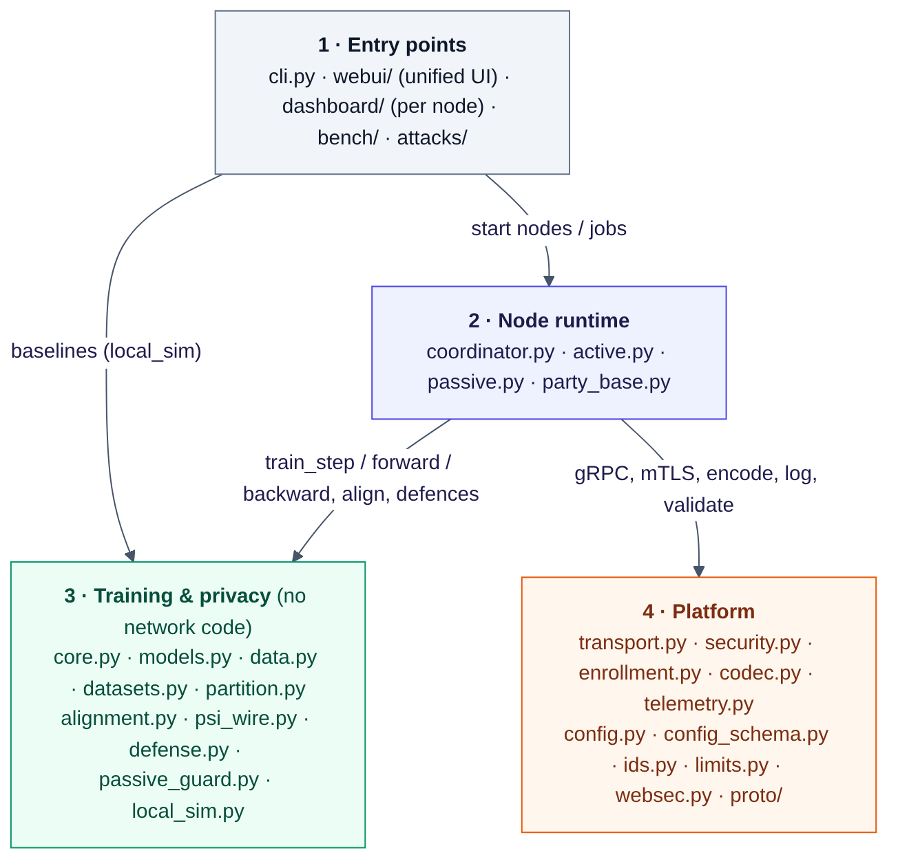
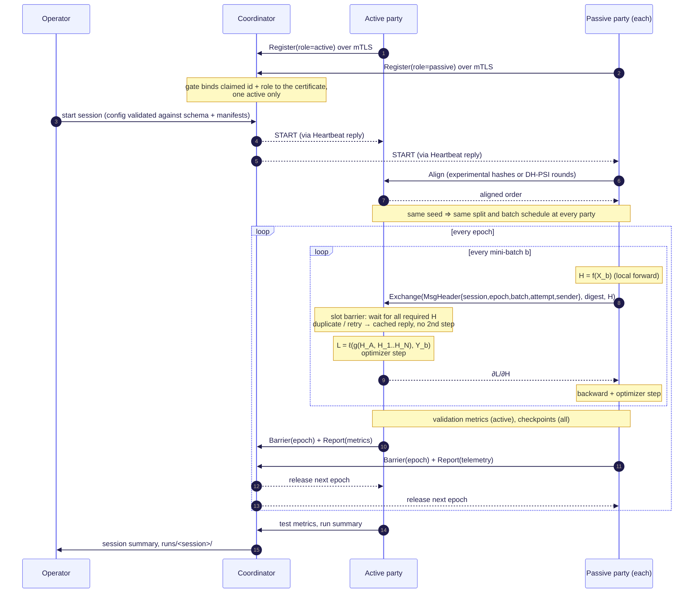
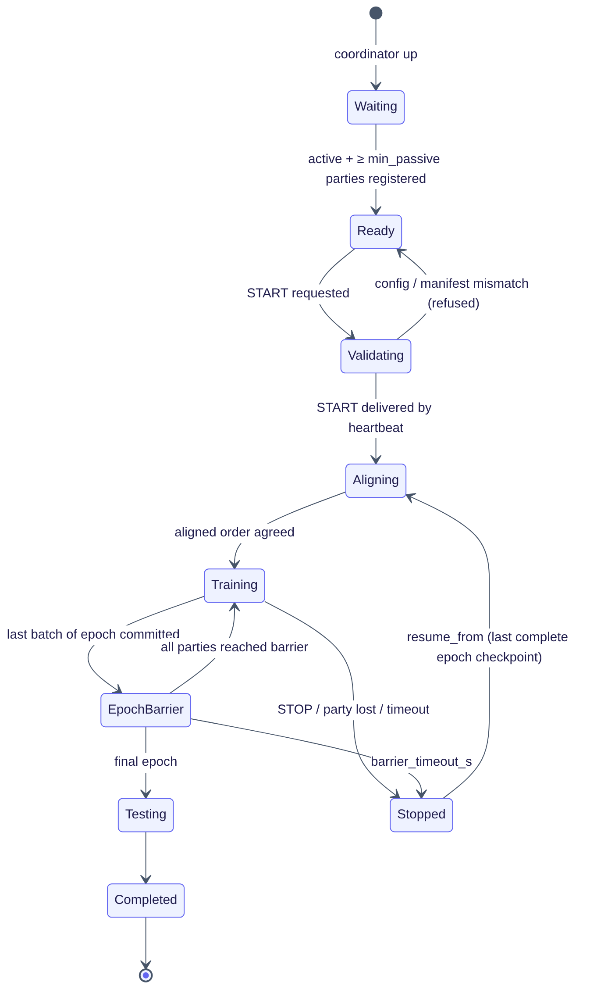
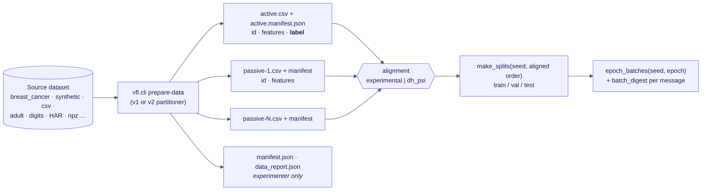

# Developer documentation

What each part of the codebase does, how the parts fit together, and how to extend them. Install and usage
instructions are in [README.md](README.md); the design and requirement mapping are in
[docs/PROJECT_DOCUMENTATION.md](docs/PROJECT_DOCUMENTATION.md); the original plan is [PRD.md](PRD.md).

Version: `vfl.__version__ == "2.3.1"` · Python 3.10–3.12 · PyTorch ≥ 2.4 (CPU) · gRPC ≥ 1.62

---

## 1. Repository layout

```
.
├── README.md  PRD.md  dev.md  CONTRIBUTORS.md  CHANGELOG-v2.md
├── proto/vfl.proto            wire protocol (source of truth for every RPC and message)
├── vfl/                       the system (importable package)
│   ├── cli.py                 single entry point: python -m vfl.cli <command>
│   ├── coordinator.py         session manager node
│   ├── party_base.py          shared party machinery (registration, heartbeats, barriers, telemetry)
│   ├── active.py  passive.py  the two party roles
│   ├── core.py                transport-independent training core (ActiveCore / PassiveCore)
│   ├── models.py              bottom / top / centralized models
│   ├── data.py  datasets.py  partition.py      data preparation, splits, batch schedules
│   ├── alignment.py  psi_wire.py                entity alignment (experimental, DH-PSI)
│   ├── defense.py  passive_guard.py             privacy defences and leakage metrics
│   ├── transport.py  security.py  enrollment.py mTLS, security gate, certificates, PKI
│   ├── codec.py  ids.py  limits.py  websec.py   encoding and input validation
│   ├── telemetry.py  metrics_curves.py          logs and metrics
│   ├── config.py  config_schema.py              session configuration
│   ├── local_sim.py                             single-process baselines (B0, B1, local VFL)
│   ├── netem_proxy.py                           RTT-injecting TCP relay
│   ├── dashboard/  webui/  attacks/             web interfaces and the lab conformance suite
│   └── proto/                                   generated stubs (do not edit)
├── bench/                     benchmarks, security tests, analysis and report
├── tests/                     pytest suite
├── configs/                   session.yaml, session.secure.yaml, synthetic.yaml, cloud_cost.example.yaml
├── docs/                      PROJECT_DOCUMENTATION.md/.pdf, DEPLOYMENT.md, CONFIG.md, diagrams/, images/
├── scripts/                   run_local.sh, stop_local.sh, gen_proto.sh
├── docker/                    Dockerfile, docker-compose.yml
└── Makefile
```

## 2. How the layers depend on each other



Rules the code follows:

* **Layer 3 has no network code.** `core.py`, `models.py`, `data.py`, `alignment.py` and `defense.py` work on numpy
  arrays and tensors only. The same core runs over gRPC (`active.py`/`passive.py`) and in one process
  (`local_sim.py`), which is how networked results are checked against local ones.
* **`config_schema.py`, `metrics_curves.py` and `psi_wire.py` must not import torch or grpc**, so the CLI client,
  the dashboards and some tests run on machines without them.
* **The web UIs never reimplement logic.** Every UI action runs the matching `python -m vfl.cli …` command as a
  background job (`vfl/webui/jobs.py`), so the UI and the CLI always give the same result.
* Generated code lives only in `vfl/proto/`. Regenerate it with `bash scripts/gen_proto.sh`.

## 3. Runtime flow



The session state machine kept by the coordinator:



## 4. Module reference

### 4.1 Entry point

| Module | What it does |
|---|---|
| `vfl/cli.py` | `argparse` front end. One `cmd_<name>` function per subcommand: `certs`, `prepare-data`, `embed-text`, `coordinator`, `active`, `passive`, `token`, `ui-user`, `ui`, `bench-ui`, `attack-ui`, `attack`, `start`, `stop`, `status`, `wait`, `config`, `baseline`, `netem`. `build_parser()` is also used by the unified UI to build argv, so a new CLI option is immediately available to the UI. |

### 4.2 Node runtime

| Module | Key classes / functions | What it does |
|---|---|---|
| `coordinator.py` | `CoordinatorState`, `Session`, `CoordinatorServicer`, `check_data_consistency`, `serve` | Membership (`register`), liveness (`heartbeat`, which also carries START/STOP commands back to parties), session start/stop with config validation, epoch `barrier`s, `report` ingestion, watchdog, resume, and the `runs/` directory. Enforces one active party and checks that every party's manifest comes from the same `prepare-data` run. Never touches tensors. |
| `party_base.py` | `PartyNode`, `StopRequested` | Base class for both parties: registers, runs the heartbeat loop, reacts to START/STOP, waits at epoch barriers, buffers per-batch telemetry and ships it to the coordinator, renews PKI certificates, and provides dashboard state. |
| `active.py` | `ActiveNode`, `ActiveSession`, `Slot`, `ActiveServicer`, `AnomalyDetector` | The label owner. `ActiveServicer` implements `Align`, `Exchange`, `Ping`. `ActiveSession.handle_exchange` checks the slot (`limits.check_slot`), the batch digest and the tensor (`codec.validate`), stores the representation in a per-batch `Slot`, and when every required passive has arrived runs `ActiveCore.train_step` once and returns the gradients. Each slot is keyed by (phase, epoch, batch) and remembers its senders; a duplicate or retry gets the cached gradient and never causes a second optimizer step (FR-8). Also hosts the multi-party PSI hub, validation/test evaluation, label-leakage metrics and fault injection. |
| `passive.py` | `PassiveNode`, `serve` | The feature owner. Runs alignment as a client, then for each batch: forward, optional representation noise, `Exchange` with retries/back-off and optional emulated RTT, validation of the returned gradient, passive-guard checks, backward step. Records the timing breakdown per batch. |

### 4.3 Training core and models

| Module | Key classes / functions | What it does |
|---|---|---|
| `core.py` | `ActiveCore`, `PassiveCore`, `utility_metrics`, `save_checkpoint`, `load_checkpoint` | `ActiveCore.train_step(H_parts, y)` concatenates the passive representations with the active bottom output, runs the top model and loss, steps the active optimizer, and returns `∂L/∂H_i` per passive. `PassiveCore.forward` / `backward_step` / `skip_step` do the passive side. Checkpoints are loaded with `weights_only=True`. Deterministic seeding (`init_seed`, `noise_secret`) lives here. |
| `models.py` | `make_bottom`, `resolve_bottom_kind`, `BottomModel`, `CNNBottom`, `CNN1dBottom`, `GRUBottom`, `TopModel`, `CentralizedMLP`, `make_optimizer`, `configure_torch` | Bottom-model registry (`mlp`, `linear`, `cnn`, `cnn1d`, `gru`, `text`). Every bottom maps its input to `[batch, embed_dim]`, which is the wire contract. `TopModel` is the active party's head (one logit + BCE for 2 classes, softmax + CE for k > 2). `CentralizedMLP` / `Stacked` give the B0 baseline at least the split model's capacity. |
| `local_sim.py` | `run_local_vfl`, `run_baselines`, `build_b0` | Single-process references on the same aligned entities, split and seeds: B0 centralized, B1 active-only, and local VFL using the same `core.py`. Used by `vfl.cli baseline` and the E1 benchmark. |

### 4.4 Data

| Module | Key functions | What it does |
|---|---|---|
| `data.py` | `prepare_vertical_dataset`, `prepare_v2`, `write_party_manifests`, `PartyData`, `make_splits`, `epoch_batches`, `eval_batches`, `batch_digest`, `Standardizer` | `prepare-data` back end (v1 and v2 generators). Writes one CSV and one manifest per party (labels only in the active party's file). `PartyData` loads a party's file and checks it against its manifest. `make_splits` and `epoch_batches` derive the split and the batch order from the seed and the aligned order, so parties agree without exchanging indices (FR-3); `batch_digest` lets the active party detect a disagreement. |
| `partition.py` | `load_dataset`, `assign_features`, `overlap_masks`, `make_ids`, `partition`, `evaluate_split` | v2 partitioner: strategies `sequential`, `random`, `dirichlet`, `importance`, `correlated`, `manual`, `image_strips`, `image_grid`; partial entity overlap; hashed ids. |
| `datasets.py` | `prepare_images`, `prepare_sensors`, `load_har`, `prepare_multimodal_digits`, `embed_text_file` | Extra modalities: `.npz` images, synthetic sensors and UCI HAR (for `cnn1d`/`gru`), multimodal digits, and frozen text-encoder embeddings (`hashing`, MiniLM, DistilBERT). |

### 4.5 Alignment and privacy

| Module | Key classes / functions | What it does |
|---|---|---|
| `alignment.py` | `ExperimentalAlignment`, `DHPSIParty`, `MultiPSIHub`, `run_psi_member`, `AlignmentResult` | Replaceable alignment interface (FR-2). `experimental`: salted-hash matching, deterministic, explicitly non-private. `dh_psi`: Diffie-Hellman PSI on the RFC 3526 2048-bit group; two-party (`DHPSIParty`) and multi-party through the active party (`MultiPSIHub` + `run_psi_member`). Output: the common ordered entity list. |
| `psi_wire.py` | `request`, `hub_reply`, `reply_dict` | Maps multi-party PSI messages to protobuf `Align` fields; protobuf only, so the whole flow is testable without a network. |
| `defense.py` | `apply_defense`, `randomized_response`, `apply_rep_noise`, `privacy_report`, `gaussian_rdp_to_dp`, `LeakageMeter` | FR-13. Gradient perturbation (clip + Gaussian noise) with an RDP accountant for that channel; randomized response on training labels (formal ε-label-DP); passive representation noise. Randomness comes from a party-local secret (`noise_source: secret`). `LeakageMeter` computes the norm and cosine label-leakage attack AUC on the gradients actually sent. |
| `passive_guard.py` | `clip_rows`, `GradientMonitor`, `leakage_audit`, `ridge_reconstruction_r2`, `guard_config` | Passive-side protections: gradient-row clipping, parameter-drift trust region, gradient anomaly monitor (warn/stop), and a per-epoch audit of how well the passive's own features can be reconstructed from what it sent. |

### 4.6 Transport, identity and validation

| Module | Key classes / functions | What it does |
|---|---|---|
| `transport.py` | `make_server`, `make_channel`, `SecurityGate`, `Policy`, `check_identity` | gRPC servers and channels with mutual TLS. `SecurityGate` is a server interceptor: per-peer rate limit, connection and concurrency caps, revocation and expiry checks, binding of the claimed sender and role to the certificate, structured security events. |
| `security.py` | `generate_all`, `make_ca`, `make_node_cert`, `make_pki`, `issue_from_csr`, `TLSFiles`, `role_of_node`, `make_token` | Certificates: `static` mode (one private CA, one cert per node, role in the SAN URI `spiffe://oncloud9/vfl/<role>/<name>`) and `pki` mode (offline root + intermediate, short-lived leaves). Join-token creation and parsing. |
| `enrollment.py` | `IdentityRegistry`, `EnrollmentServicer`, `enroll_party`, `renew_party` | PKI enrollment service run by the coordinator: join tokens or operator approval, CSR validation, renewal with proof of possession, revocation by identity. |
| `codec.py` | `encode`, `decode`, `validate`, `tensor_bytes`, `TensorRejected` | Tensor ↔ protobuf (`fp32`, `fp16`, `int8` per-row scale, sparse `topk`), byte accounting for NFR-4, and validation of every received tensor (declared shape, element cap, finiteness, optional row-norm bound). |
| `ids.py` | `check_party_id`, `check_session_id`, `one_line`, `check_ui_url` | Validation of identifiers and strings that cross a trust boundary (safe path components, bounded single-line strings, http(s)-only links). |
| `limits.py` | `check_slot`, `psi_item_cap` | Protocol limits on authorised peers: which (epoch, batch) slots may be addressed, and how many ids a party may submit for alignment. |
| `websec.py` | `install`, `host_allowed`, `tokens_equal`, `LoginThrottle` | HTTP hardening shared by every web UI: Host allow-list, Origin checks, JSON/`X-VFL-Request` requirement for actions, constant-time token compare, login throttling, CSP and related headers. |

### 4.7 Configuration

| Module | What it does |
|---|---|
| `config_schema.py` | **Single source of truth for every session key.** `PARAMS` is a tuple of `Param(key, type, default, group, help, presets, choices, min, max, applies_to, show_if, widget, …)`. From it come the defaults, the validator, `--set` checking with "did you mean" suggestions, the dashboard form (`GET /api/config/schema`), `docs/CONFIG.md` and the README table. |
| `config.py` | Loads `configs/*.yaml`, merges overrides (`--set k=v`, form values), validates through the schema, derives the alignment salt. |

### 4.8 Telemetry

| Module | What it does |
|---|---|
| `telemetry.py` | `SessionLog` writes `logs/<party>/<session>/batches.jsonl` (per batch: forward/encode/RPC/network/wait/compute/backward ms, tensor and serialized bytes, attempts, duplicates), `epochs.jsonl`, `run_summary.json` (with software versions and determinism settings). `ResourceMonitor` samples CPU/RSS. `SecurityLog` writes `logs/<node>/security.jsonl`. Records never contain ids, feature values or labels. |
| `metrics_curves.py` | Down-sampled ROC points and confusion counts for the analytics page. |
| `netem_proxy.py` | TCP relay that adds RTT, counts wire bytes and can capture traffic (used by E2 and the packet scan). |

### 4.9 Web interfaces

| Package | What it does |
|---|---|
| `vfl/dashboard/` | One Flask app per node (`create_app`), role-aware views (coordinator :8080, active :8081, passive :8082…), the session form (`static/config_form.js`), Prometheus `/metrics`, optional users (`--ui-users`) and token. |
| `vfl/webui/` | Unified UI on :8090: `dataprep.py` (data preparation form → `prepare-data` argv, previews, saved datasets), `deploy.py` (`DeploymentManager`: local launch of N nodes, multi-machine bundles, node status/logs/restart), `jobs.py` (`JobManager`: background subprocesses with log tail, cancel, rerun), `__init__.py` (routes for training, tests & benchmarks, analytics, reports). Static assets are vendored; nothing loads from a CDN. |
| `vfl/attacks/` | Lab-only conformance suite: `runner.Harness` has one `case_*` per class of bad request; `suite.run` resolves targets, refuses hosts outside the lab config, and writes `report.json/.csv`, `summary.txt`. `lab.py` and `jobs.py` launch it from the coordinator's Security tab and the unified UI. |

### 4.10 Benchmarks and analysis

| File | What it does |
|---|---|
| `bench/harness.py` | `LocalDeployment` launches coordinator + parties as separate processes; `Coordinator` drives any deployment through its HTTP API. |
| `bench/run_benchmarks.py` | `Runner` implements the PRD evaluation plan: `e1`, `e2`, `eff`, `def`, `psi`, `e5`, `sweep`, `lopo`. |
| `bench/security_test.py` | E3: 100 invalid-certificate attempts, impersonation checks, packet-capture scan, sentinel log audit. |
| `bench/analyze.py` | Turns a results directory into figures, `nfr_table.md/.csv`, `requirements_matrix.md` and `report.md`. The unified UI's Analytics page calls the same functions. |
| `bench/ui.py` | Back end for the Tests & Benchmarks and Analytics pages. |

## 5. Wire protocol

`proto/vfl.proto` defines three services:

| Service | RPCs | Called by |
|---|---|---|
| `Coordinator` | `Register`, `Heartbeat`, `Barrier`, `Report` | every party |
| `ActiveParty` | `Align`, `Exchange`, `Ping` | passive parties |
| `Enrollment` | `Enroll`, `Renew` | parties in PKI mode |

Every training message has a `MsgHeader` (session, epoch, batch, attempt, sender, type). A `Tensor` message carries
dtype, shape, codec and payload. After editing the proto:

```bash
bash scripts/gen_proto.sh       # regenerates vfl/proto/vfl_pb2.py and vfl_pb2_grpc.py
pytest -q                       # protocol changes must keep the end-to-end tests passing
```

Add new fields with new tag numbers only; never renumber or reuse a tag, so mixed versions keep working.

## 6. Data and configuration flow



## 7. Extending the system

### Add a session configuration key

1. Add a `_p(...)` entry to `PARAMS` in `vfl/config_schema.py` (type, default, group, help, presets, constraints).
2. Read it in the code with `cfg["your_key"]` (or the dotted path).
3. Regenerate the docs: `python -m vfl.cli config docs --out docs/CONFIG.md --readme README.md`.
4. `pytest -q tests/test_config_schema.py` — it scans the code and fails if a key is read but not declared, or if
   the README table is stale.

### Add a bottom model

1. Implement an `nn.Module` in `vfl/models.py` that maps the party input to `[batch, embed_dim]`.
2. Register it in `make_bottom` (and in `SHAPED` if it needs a manifest `shape`), and add the name to
   `BOTTOM_MODELS` in `vfl/config_schema.py`.
3. Add its hyperparameters as schema keys with `applies_to=("your_kind",)` so the form shows them only when used.
4. Add a shape/update test to `tests/test_models_v21.py`.

### Add an alignment method

Follow `ExperimentalAlignment` / `DHPSIParty` in `vfl/alignment.py`: the result must be the same ordered entity list
at every party. Wire it into `ActiveSession` (server side) and `PassiveNode.align` (client side), add the name to
the `alignment` choices in the schema, and document what each party learns.

### Add a defence

Add the mechanism to `vfl/defense.py` (draw randomness from the party secret, never from the shared seed), call it
from the point where the tensor is produced, add its parameters under `defense.*` in the schema, and extend
`privacy_report` so the run log states what is and is not guaranteed. Measure it with the `def` benchmark suite.

### Add a dataset or partition strategy

Datasets go in `vfl/datasets.py` or `vfl/partition.load_dataset`; strategies in `partition.assign_features`. Add the
name to the CLI choices and the schema's `PARTITION_STRATEGIES`, and a test to `tests/test_partition.py`.

### Add a CLI command

Add `cmd_<name>` and a subparser in `vfl/cli.py`, then a UI route in `vfl/webui/__init__.py`.
`tests/test_webui.py::test_every_cli_subcommand_has_a_ui_route` fails until the UI covers it.

## 8. Tests

```bash
pytest -q                    # everything, including end-to-end runs that launch real processes over mTLS
pytest -q -m "not slow"      # skip the end-to-end tests
pytest -q tests/test_core.py # one file
```

| File(s) | Covers |
|---|---|
| `test_data.py`, `test_partition.py`, `test_dataprep.py` | splits, batch determinism, label ownership, partition strategies, data-prep UI |
| `test_models.py`, `test_models_v21.py`, `test_core.py`, `test_codec.py` | model shapes, parameter updates, codec round trips and byte counts |
| `test_alignment.py`, `test_multiparty_psi.py` | experimental alignment, 2-party and multi-party DH-PSI |
| `test_defense.py`, `test_defence_randomness.py`, `test_passive_guard.py` | defences, secret randomness, passive guard |
| `test_coordinator.py`, `test_integration.py` | roles, session preconditions, networked run vs local, duplicate/delay faults |
| `test_security_gate.py`, `test_enrollment.py`, `test_redteam.py` | gate policies, PKI and enrollment, security regression tests |
| `test_config_schema.py` | schema completeness, validation, generated docs in sync |
| `test_webui.py`, `test_deploy.py`, `test_analytics.py`, `test_bench_ui.py`, `test_attacks_standalone.py` | UIs, deployment manager, analytics, conformance suite |
| `conftest.py`, `fake_node.py`, `bench_fixture.py`, `config_scan.py` | fixtures and helpers |

Tests marked `slow` start real processes; the rest run in-process (gRPC handlers are driven with a fake context).

## 9. Conventions

* Every node logs human-readable events to `logs/<node>/<node>.events.log` (`--log-level DEBUG` for more); never
  log entity ids, feature values or labels — the sentinel audit in `bench/security_test.py` checks this.
* New behaviour is opt-in through a schema key whose default keeps the previous behaviour, so earlier results stay
  reproducible (NFR-2). Note the version in `Param(since=...)`.
* Values received from another node are validated before use (`codec.validate`, `ids.*`, `limits.*`).
* Generated files (`vfl/proto/*`, `docs/CONFIG.md`, the README config table) are regenerated, not hand-edited.
* Runtime output (`certs/`, `data/`, `logs/`, `runs/`, `checkpoints/`, `results/`, UI workspace folders) is
  git-ignored and must never be committed.
* Diagrams are Mermaid sources in `docs/diagrams/*.mmd`, rendered to `docs/images/*.png` with
  `mmdc -i docs/diagrams/X.mmd -o docs/images/X.png -b white -s 2`.
