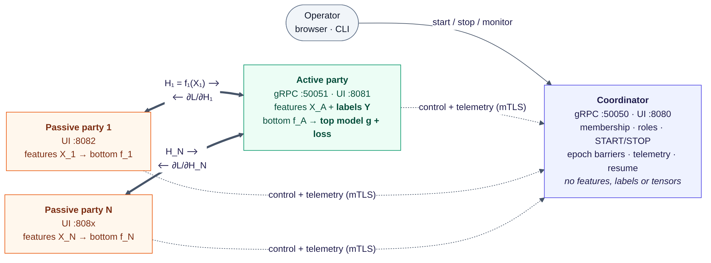
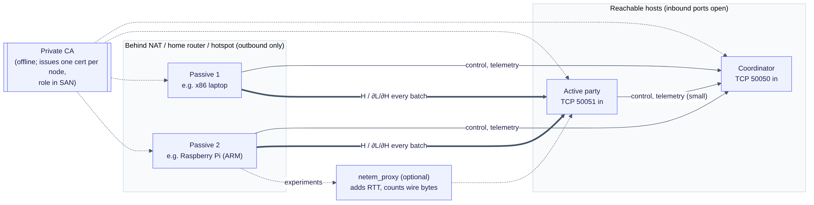
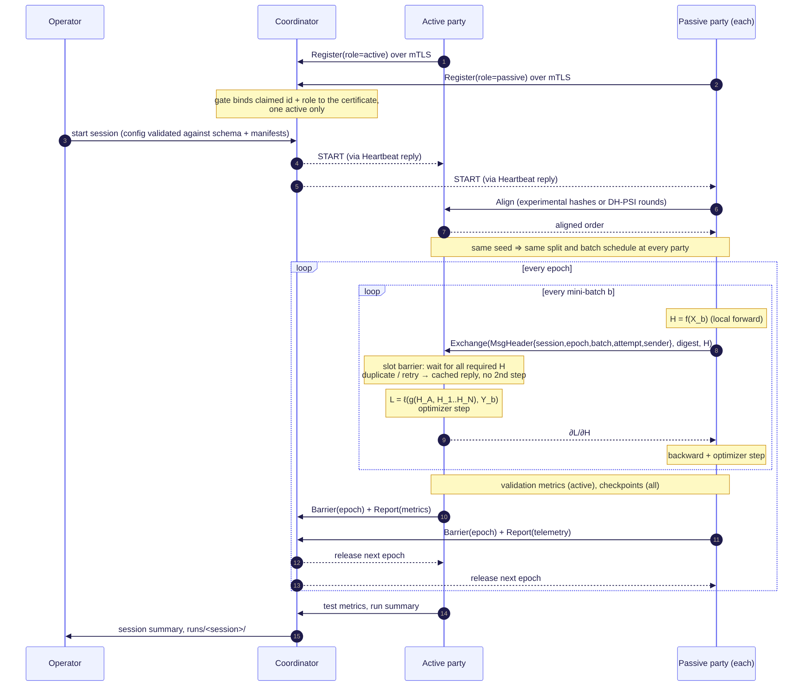
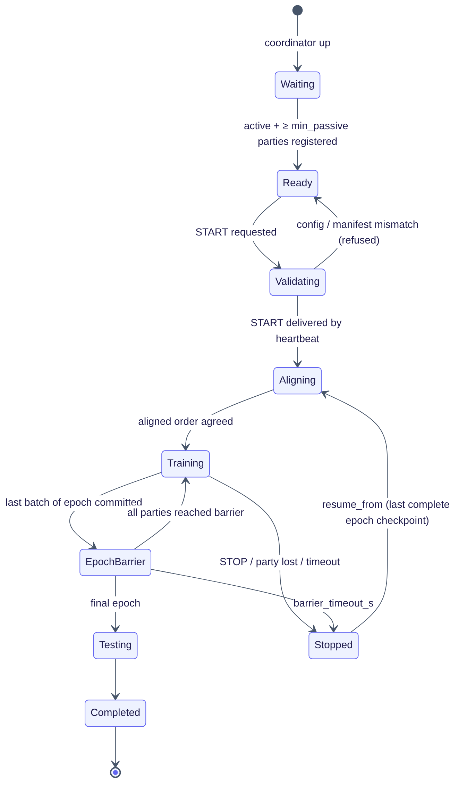
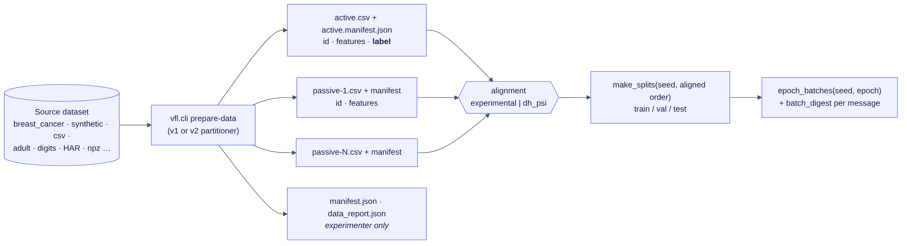
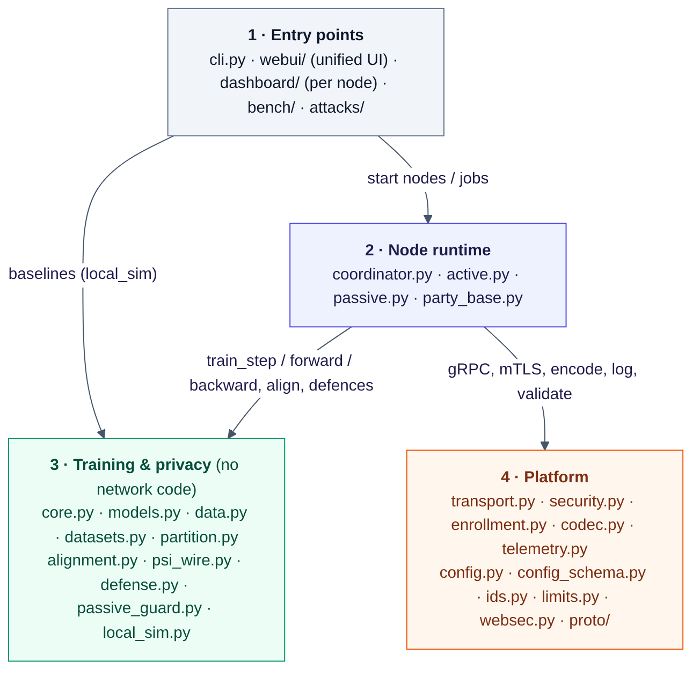

# VFL System v2.3.1 — Project Documentation

**Vertical Federated Learning over Heterogeneous Networked Systems**
Privacy-preserving VFL with central coordination · Team **OnCloud9** · DS252 · release `v2.3.1` (November 2026)

| Member | Roll no. | Area |
|---|---|---|
| Amisha Sadhukan | 26386 | Systems — certificates and PKI, security gate, CLI, unified UI back end, deployment |
| Atrayee Samanta | 26437 | Systems — wire protocol, coordinator, party runtime, transport, telemetry, dashboards |
| Lavish Singh | 26318 | ML — alignment and PSI, privacy defences, conformance suite, benchmarks and analysis |
| M. Divya | 26454 | ML — data and partitioning, models, training core, baselines, configuration schema |

| Document | What it covers |
|---|---|
| [`README.md`](../README.md) | install, quick start, every CLI command, full configuration table, UI walkthrough |
| [`PRD.md`](../PRD.md) | the original project plan (PRD v3) |
| [`dev.md`](../dev.md) | developer documentation: what each module does and how to extend it |
| [`docs/DEPLOYMENT.md`](DEPLOYMENT.md) | separate machines: LAN, VPN, cloud VMs, port forwarding, PKI enrollment |
| [`docs/CONFIG.md`](CONFIG.md) | generated reference for every session key |
| [`CHANGELOG-v2.md`](../CHANGELOG-v2.md) · [`CONTRIBUTORS.md`](../CONTRIBUTORS.md) | changes from v1 to v2.3.1 · who owns which part |

---

## 1. Problem and goal

In vertical federated learning (VFL), several organisations hold **different features about the same entities**.
One party (the *active* party) also holds the labels. They want to train one model jointly without pooling raw
data [2, 3]. In split-model VFL each party runs a local *bottom model* on its own features and sends only the resulting
representation; the active party combines the representations in a *top model*, computes the loss with its labels
and sends each party the gradient of the loss with respect to that party's representation [2, 6].

This exchange happens **for every mini-batch**, so entity alignment, synchronisation, network latency,
communication volume and information leakage through the exchanged tensors are the central systems problems [2, 3, 7].

The PRD's research question:

> How do batch-level synchronisation, network placement and feature partitioning affect the utility and systems
> cost of a reproducible VFL deployment?

The project delivers a networked, reproducible VFL system that answers this question by measurement, plus the
conditional privacy extensions the PRD lists (PSI, an inference defence and a cloud-cost model) [15].

## 2. Scope

| | In this release |
|---|---|
| **Core (PRD MVP)** | one active + one or more passive parties + a separate coordinator, as separate processes or machines; deterministic alignment through a replaceable interface; deterministic mini-batches; split PyTorch models; synchronous per-batch training; gRPC/Protocol Buffers over mutual TLS; duplicate suppression; machine-readable telemetry; centralized (B0) and active-only (B1) baselines; RTT and batch-size sweeps; fault injection |
| **Conditional (done)** | DH-PSI alignment for two or more parties (FR-12); gradient-noise and randomized-response label defences with label-leakage attack metrics (FR-13); cloud-cost model (NFR-9) |
| **Beyond the PRD (v2–v2.3.1)** | multiple passive parties; CNN, 1-D CNN, GRU and frozen-text-encoder bottom models; multi-class; v2 partitioner (Dirichlet, importance, correlated, image strips/grid…); fp16/int8/top-k codecs; straggler `drop` policy; checkpoint resume; PKI with short-lived certificates and enrollment; live security gate; node dashboards and a unified UI; standalone conformance suite; passive-side protections |
| **Not attempted** | Flotilla adapter (FR-14, stretch) [1]; asynchronous training; crash-safe exactly-once execution; one coordinator running concurrent sessions with different active parties |

**Assumptions (from the PRD).** Parties agree on a stable entity identifier format. Experiments use public or
synthetic data. The primary threat model is **honest-but-curious**: parties follow the protocol but may try to infer
what they can from what they legitimately receive. The coordinator does not see training payloads. Transport
security protects against network observers, not against inference by an authorised recipient [14, 6].

## 3. Architecture



*Figure 1. Nodes, ports and flows. Thick arrows carry tensors every batch; dotted arrows carry control and
telemetry.*

### 3.1 Roles and trust boundary

| Node | Holds | Sends | Never receives |
|---|---|---|---|
| **Active party** | its feature columns `X_A`, the **labels `Y`**, bottom model `f_A`, **top model `g`**, loss | `∂L/∂H_i` to each passive; utility and leakage metrics to the coordinator | raw passive features |
| **Passive party *i*** | its feature columns `X_i`, bottom model `f_i` | `H_i = f_i(X_i)` to the active party | labels, other parties' data |
| **Coordinator** | session configuration, membership, schedule, telemetry | START/STOP, barrier releases | features, labels, representations, gradients |

The coordinator is deliberately outside the data path: representations and gradients flow **directly between
parties**. Labels and the top model never leave the active party. Other top-model placements would need a
separate privacy analysis [2, 6].

For aligned batch *b*, party *i* computes `H_i = f_i(X_i^b)`; the active party computes
`L_b = ℓ(g(H_A, H_1, …, H_N), Y^b)` and returns `∂L_b/∂H_i` to each passive party.

### 3.2 Deployment topology



*Figure 2. Only the coordinator (TCP 50050) and the active party (TCP 50051) accept inbound connections. Passive
parties only dial out, so they can sit behind NAT — this is what lets laptops and Raspberry Pis at different sites
join (heterogeneous devices). The optional relay injects RTT and counts wire bytes for experiments.*

| Node | Needs inbound | Connects out to |
|---|---|---|
| coordinator | TCP 50050 from every party | — |
| active | TCP 50051 from every passive | coordinator:50050 |
| passive | — | coordinator:50050, active:50051 |
| dashboards | 8080 / 8081 / 808x only for remote viewing | — |

### 3.3 Wire protocol (`proto/vfl.proto`)

| Service | RPC | Purpose |
|---|---|---|
| `Coordinator` | `Register` | join with a role; the role is checked against the certificate |
| | `Heartbeat` | liveness; the reply carries control commands (START with config, STOP) |
| | `Barrier` | epoch barriers so all parties advance epoch by epoch |
| | `Report` | telemetry and metrics upload |
| `ActiveParty` | `Align` | entity alignment (experimental hashing or DH-PSI rounds) |
| | `Exchange` | one batch: passive sends `H_i`, receives `∂L/∂H_i` |
| | `Ping` | RTT measurement |
| `Enrollment` | `Enroll`, `Renew` | PKI mode: certificate issuance and renewal with a join token |

Every training message carries a `MsgHeader` with **session, epoch, batch, attempt, sender and message type**, plus
a digest of the batch membership. Tensors are encoded by `vfl/codec.py` (fp32, fp16, int8 or top-k) with byte
accounting for NFR-4. gRPC and Protocol Buffers were chosen for typed services, deadlines and compact binary
payloads [9, 10].

### 3.4 One training run



*Figure 3. Message sequence of a session.*

1. **Setup.** `prepare-data` creates one CSV and one manifest per party. `certs` creates a private CA and one
   certificate per node with the role in the SAN (`static` mode), or a PKI with an offline root (`pki` mode).
2. **Registration.** Each node registers with the coordinator over mTLS. The security gate binds the claimed
   identity and role to the certificate. Only one active party is allowed; a passive holding labels is refused.
3. **Session start.** The operator starts a session (dashboard, unified UI or `vfl.cli start`). The coordinator
   validates the configuration against `vfl/config_schema.py` and every party's manifest, then sends START.
4. **Alignment.** Passives align with the active party through the replaceable alignment interface
   (`experimental` or `dh_psi`). The result is a common ordered entity list.
5. **Splits and batches.** Every party derives the same train/validation/test split and batch order from the seed
   and the aligned order. No indices are exchanged.
6. **Per batch.** Each passive computes `H_i` and calls `Exchange`. The active party waits until every required
   representation for the slot has arrived (synchronous barrier), computes the loss, steps its models, and returns
   `∂L/∂H_i`. Each passive steps its bottom model. Duplicates and retries get the cached reply, so they never cause
   a second optimizer step.
7. **Per epoch.** Validation metrics at the active party, checkpoints at every party, epoch barrier at the
   coordinator, telemetry flush.
8. **End.** Test metrics, run summary (with software versions and determinism settings), session index entry.

### 3.5 Session lifecycle



*Figure 4. Coordinator session states, including refusal on configuration mismatch and resume from the last
complete epoch checkpoint.*

### 3.6 Data pipeline



*Figure 5. From a source dataset to per-party files, alignment and deterministic batches. Each machine receives only
its own CSV and manifest; the full manifest and data report stay with the experimenter. The v2 partitioner's
strategies (Dirichlet, importance, correlated) follow VertiBench's point that arbitrary feature splits can hide
distribution effects [4].*

### 3.7 Code structure



*Figure 6. Code layers. The training and privacy layer has no network code, so the same core runs over gRPC and in
a single process for the baselines. Module-by-module detail is in [`dev.md`](../dev.md).*

## 4. Technology choices

| Choice | Why | Alternative considered |
|---|---|---|
| Split PyTorch models [2, 6] | the standard VFL representation/gradient workflow; tensor-level correctness tests | — (leakage is measured, not assumed away) |
| Central coordinator, tensors party-to-party [1, 2] | clear trust boundary; the coordinator stays out of the data path | coordinator as relay (would have to be in the threat model) |
| Synchronous per-batch execution [3, 7] | simple correctness and clean attribution of wait time | asynchronous training (deferred, not assumed better) |
| gRPC + Protocol Buffers [9, 10] | typed services, deadlines, streaming, efficient binary payloads | REST/HTTP (no performance claim either way) |
| Mutual TLS, role in the certificate [14] | authenticates both ends and binds identity and role | server-only TLS |
| DH-PSI [8] | well-understood semi-honest PSI that works for any number of parties | OT-extension PSI [13] (faster, much more complex) |
| Randomized response on labels [11] | gives a **formal** ε-label-DP guarantee for everything sent to passives | DP-SGD on the top model [12] (does not cover the transcript by itself) |
| Docker, LAN, then cloud | reproducible packaging; local fallback; controlled RTT injection [1] | — |

## 5. Requirements traceability

Measured values are produced by `make bench` into `results/bench/report/nfr_table.md` (measured value + pass/fail/
not attempted); they are not repeated here because benchmarking continues after the code submission.

### 5.1 Functional requirements

| ID | Priority | Requirement (short) | Status | Where in the code | How it is verified |
|---|---|---|---|---|---|
| FR-1 | Must | start active, ≥1 passive, coordinator; reject bad roles | Done | `coordinator.register` / `start_session`; role in certificate SAN | `tests/test_coordinator.py` |
| FR-2 | Must | replaceable alignment; experimental mode returns the reference intersection, labelled non-private | Done | `alignment.py` adapter interface | `tests/test_alignment.py`; sentinel log audit |
| FR-3 | Must | deterministic aligned mini-batches | Done | `data.make_splits`, `data.epoch_batches`; batch digest checked per message | `tests/test_data.py`, E1 same-seed repeat |
| FR-4 | Must | parties send representations, not raw features or labels | Done | passive sends only `f_i(X_i)`; the protocol has no feature/label fields | packet-capture scan in `bench/security_test.py` |
| FR-5 | Must | active combines representations, computes loss, returns correctly shaped gradients | Done | `core.ActiveCore.train_step` | `tests/test_core.py`, `tests/test_integration.py` |
| FR-6 | Must | synchronous per-batch execution; injected delay shows in wait time | Done | slot barrier at the active party; epoch barriers at the coordinator | E2 RTT sweep, E5 delay injection |
| FR-7 | Must | local parameters change after a committed batch | Done | `core.PassiveCore.backward_step` | `tests/test_core.py` |
| FR-8 | Must | messages identified by session/epoch/batch/attempt/sender/type; duplicates cause no extra step | Done | `MsgHeader`; idempotent slot cache at the active party | E5 duplicate injection; `tests/test_integration.py` |
| FR-9 | Must | configure dataset, seed, batch size, model dims, epochs without code edits | Done | `config_schema.py`, `configs/*.yaml`, `--set`, dashboard form | `tests/test_config_schema.py`, `tests/test_data.py::test_three_batch_sizes`; E2 |
| FR-10 | Must | machine-readable per-batch and per-run records | Done | `telemetry.py`; coordinator `runs/` | `batches.jsonl`, `run_summary.json` |
| FR-11 | Must | authenticated, encrypted transport; invalid credentials refused | Done | `security.py`, `transport.py`, security gate | `bench/security_test.py` (100 invalid-cert attempts, packet scan), `tests/test_security_gate.py` |
| FR-12 | Could | PSI alignment; document who learns the intersection | Done (semi-honest DH-PSI) | `alignment.DHPSIParty`, `alignment.MultiPSIHub` | `tests/test_multiparty_psi.py`, `psi` suite; disclosure in §6.2 |
| FR-13 | Could | one configurable defence against a training-time inference threat, with attack metric | Done | `defense.py` (gradient noise, randomized-response labels), norm and cosine label-leakage attacks | `tests/test_defense.py`, `tests/test_defence_randomness.py`, `def` suite |
| FR-14 | Could | Flotilla adapter | Not attempted | — | — |

### 5.2 Non-functional requirements

| ID | Target | Produced by |
|---|---|---|
| NFR-1 Utility | VFL test AUROC within 5 pp of centralized, same aligned entities, 3 seeds | E1 |
| NFR-2 Reproducibility | same seed → identical aligned order and step count; final-loss variation reported | E1 same-seed repeat; `run_summary.json` records versions and determinism settings |
| NFR-3 Latency | median epoch time and p50/p95 batch time at RTT 0/20/50/100 ms | E2 through `netem_proxy` |
| NFR-4 Communication | tensor, serialized and wire bytes separately, per epoch and per entity | E2; codec byte accounting + relay wire counts |
| NFR-5 Throughput | ≥ 5 committed batches/s on LAN without delay, or achieved value and bottleneck | E2 |
| NFR-6 Efficiency | CPU/memory per node; fp16 vs fp32 with paired seeds | `eff` suite; `resources.jsonl` |
| NFR-7 Transport and logging | 100/100 invalid certificates refused; zero sentinel values in logs | `bench/security_test.py` |
| NFR-8 Privacy evaluation | defence parameters, adjacency, accountant, attack metric, utility, overhead; PSI disclosure, time, bytes [5, 11, 12] | `def` and `psi` suites |
| NFR-9 Cloud cost | VM time, storage, egress with a price snapshot; cost per 1,000 entities and per epoch | `bench/analyze.py --cost configs/cloud_cost.example.yaml` (conditional on a cloud run) |
| NFR-10 Fault handling | duplicate + 2 s delay; no duplicate step; checkpoint recovery time | E5 |

### 5.3 Evaluation plan → commands

| PRD experiment | Command |
|---|---|
| E1 correctness and utility (B0, B1, C1) | `python bench/run_benchmarks.py --suites e1` |
| E2 network and efficiency | `python bench/run_benchmarks.py --suites e2,eff,sweep` |
| E3 security and conditional privacy | `python bench/security_test.py --plaintext-control`; `--suites def,psi` |
| E4 cloud cost | `python bench/analyze.py results/<run> --cost configs/cloud_cost.example.yaml` |
| E5 fault and reproducibility | `python bench/run_benchmarks.py --suites e5` |
| Everything + report | `make bench` → `results/bench/report/report.md`, `nfr_table.md`, `requirements_matrix.md` |
| Smoke check (~3 min) | `make bench-quick` |

## 6. Privacy and security design

### 6.1 Mechanisms

| Mechanism | Purpose | Default |
|---|---|---|
| mTLS with role in the certificate, live security gate | authenticate every peer, bind identity and role, rate and connection limits, revocation | on (`--insecure` only on loopback) |
| Tensor validation (shape, finiteness, optional norm bounds) | refuse malformed tensors | shape/finiteness on |
| `experimental` alignment | reproducible reference alignment, labelled **non-private** (FR-2) | default |
| `dh_psi` alignment | private set intersection (FR-12) | hardened profile |
| `defense.label_rr_epsilon` | randomized response on training labels — **formal ε-label-DP** | hardened profile (ε = 2) |
| `defense.type: grad_noise` | clip + Gaussian noise on `∂L/∂H`, RDP figure for that channel | off |
| `defense.rep_noise_sigma`, `security.private_init` | representation noise; secret passive initialisation | off / hardened profile |
| Passive guard (`security.passive_grad_clip`, `max_param_drift`, `grad_monitor`, `leakage_audit`) | bound and monitor what a passive accepts | off / hardened profile |
| Web hardening (`websec.py`) | Host allow-list, Origin checks, tokens, CSP for every dashboard | on |
| Sentinel log audit | verify no raw values or labels reach logs | test-time check |

Two configuration profiles:

* `configs/session.yaml` — **reproducible defaults** used by the NFR-2 benchmarks.
* `configs/session.secure.yaml` — **hardened profile** for real data: DH-PSI, ε = 2 label-DP with secret noise,
  `private_init`, norm bounds, anomaly detection and the passive guard.

### 6.2 What DH-PSI discloses (FR-12)

Every party learns the global intersection and the set sizes. In the multi-party protocol (two or more passives,
through the active party) the active party additionally learns which passives hold each of its own ids and the
sizes of sub-intersections; passive parties learn nothing more. The protocol assumes semi-honest parties. As the PRD notes, PSI can reveal the matched intersection depending on its
output policy [8, 5].

### 6.3 Defence accounting (FR-13, NFR-8)

* **Randomized response** (`label_rr_epsilon`): protected information = each entity's training label; neighbouring
  datasets differ in one label; the trained model and every gradient sent to passives are ε-label-DP (δ = 0) by
  post-processing [11]. Validation/test metrics use true labels and are outside that scope.
* **Gradient noise** (`grad_noise`): per-row clip `C` and Gaussian noise `σ·C` on `∂L/∂H`, accounted with RDP for the
  gradient channel (also reported for colluding passives). Reported as perturbation, not an end-to-end guarantee [11, 12].
* Both are evaluated with the norm and cosine label-leakage attack AUC on the gradients actually sent, with utility
  and overhead on paired seeds, following the privacy-utility evaluation of [5] and the label-leakage threat
  of [6].

### 6.4 Version history of the security work

| Version | Work |
|---|---|
| v1 | mTLS, certificate-name binding, duplicate suppression, sentinel log audit |
| v2 | live security gate, PKI with enrollment, DH-PSI, label-DP, structured security event log |
| v2.1 | party-local secret randomness for every defence, collusion-aware budget, multi-party PSI, `private_init` |
| v2.3 | role-bearing certificates, safe checkpoint loading, web UI CSRF/DNS-rebinding protection, input bounds on authorised peers; regression tests in `tests/test_redteam.py` |
| v2.3.1 | passive guard; token required for every dashboard view on non-loopback addresses |

## 7. Reproducing the results

```bash
git clone <repo-url> && cd oncloud9-vfl
python3 -m venv .venv && source .venv/bin/activate
pip install torch --index-url https://download.pytorch.org/whl/cpu
pip install -r requirements.txt
pytest -q                                           # full suite incl. end-to-end runs over mTLS
make data certs local                               # coordinator + active + passive on this machine
python -m vfl.cli start --set epochs=10 --wait
make bench                                          # full evaluation plan and report
```

Python 3.10–3.12, CPU-only PyTorch ≥ 2.4. Runs on x86-64 and ARM (Raspberry Pi 4/5, Apple Silicon). Multi-machine
instructions are in [`DEPLOYMENT.md`](DEPLOYMENT.md). Logs and results (`logs/`, `runs/`, `checkpoints/`,
`results/`) contain no entity ids, feature values or labels and are git-ignored.

## 8. Scope of the guarantees

As the PRD requires, each mechanism is described for what it guarantees and nothing more.

1. The default alignment (`experimental`) is a reproducible reference and is labelled non-private; `dh_psi` is the
   private option.
2. DH-PSI is a textbook semi-honest protocol implemented for this study; it has not been externally reviewed.
3. Only `label_rr_epsilon` gives a formal guarantee, for the trained model and the gradients sent to passives.
   Gradient and representation noise are perturbation.
4. mTLS stops outsiders and impersonation; it does not hide tensors from their authorised recipient.
5. The core threat model is honest-but-curious; deviating parties are bounded and monitored, not ruled out.
6. Duplicate suppression covers an uninterrupted run; restart is epoch-checkpoint based, not exactly-once.
7. One active party per session. FR-14 (Flotilla) was not attempted.

## 9. References

Numbered as in [`PRD.md`](../PRD.md); bracketed numbers in the text refer to this list.


1. R. Banerjee et al., "Flotilla: A Scalable, Modular and Resilient Federated Learning Framework for Heterogeneous
   Resources," *Journal of Parallel and Distributed Computing*, vol. 203, article 105103, 2025.
   doi:10.1016/j.jpdc.2025.105103.
2. Y. Liu et al., "Vertical Federated Learning: Concepts, Advances and Challenges," *IEEE Transactions on Knowledge
   and Data Engineering*, 2024; arXiv:2211.12814.
3. K. Wei et al., "Vertical Federated Learning: Challenges, Methodologies and Experiments," arXiv:2202.04309, 2022
   (revised 2024).
4. Z. Wu, J. Hou, and B. He, "VertiBench: Advancing Feature Distribution Diversity in Vertical Federated Learning
   Benchmarks," ICLR, 2024; arXiv:2307.02040.
5. Y. Kang et al., "A Framework for Evaluating Privacy-Utility Trade-off in Vertical Federated Learning,"
   arXiv:2209.03885, 2022 (revised 2024).
6. S. Kariyappa and M. K. Qureshi, "ExPLoit: Extracting Private Labels in Split Learning," arXiv:2112.01299, 2022.
7. J. Sun et al., "Communication-Efficient Vertical Federated Learning with Limited Overlapping Samples," in *Proc.
   IEEE/CVF ICCV*, pp. 5203–5212, 2023.
8. D. Buckley, M. Durkee, J. Near, and D. Darais, "Input privacy for vertical federated learning," UK Responsible
   Technology Adoption Unit / NIST Privacy Engineering Collaboration Space, 2024.
   https://rtau.blog.gov.uk/2024/05/02/input-privacy-for-vertical-federated-learning/
9. gRPC, "Core concepts, architecture and lifecycle." https://grpc.io/docs/what-is-grpc/core-concepts/
10. Protocol Buffers, "Protocol Buffers Documentation." https://protobuf.dev/
11. C. Dwork and A. Roth, "The Algorithmic Foundations of Differential Privacy," *Foundations and Trends in
    Theoretical Computer Science*, vol. 9, nos. 3–4, pp. 211–487, 2014. doi:10.1561/0400000042.
12. M. Abadi et al., "Deep Learning with Differential Privacy," in *Proc. ACM CCS*, pp. 308–318, 2016.
    https://arxiv.org/abs/1607.00133
13. B. Pinkas, T. Schneider and M. Zohner, "Scalable Private Set Intersection Based on OT Extension," *ACM
    Transactions on Privacy and Security*, vol. 21, no. 2, article 7, 2018. doi:10.1145/3154794.
14. E. Rescorla, "The Transport Layer Security (TLS) Protocol Version 1.3," RFC 8446, 2018.
    https://www.rfc-editor.org/rfc/rfc8446
15. DS252, "Project Requirements Document (PRD): Instructions," supplied course document, 2026.
